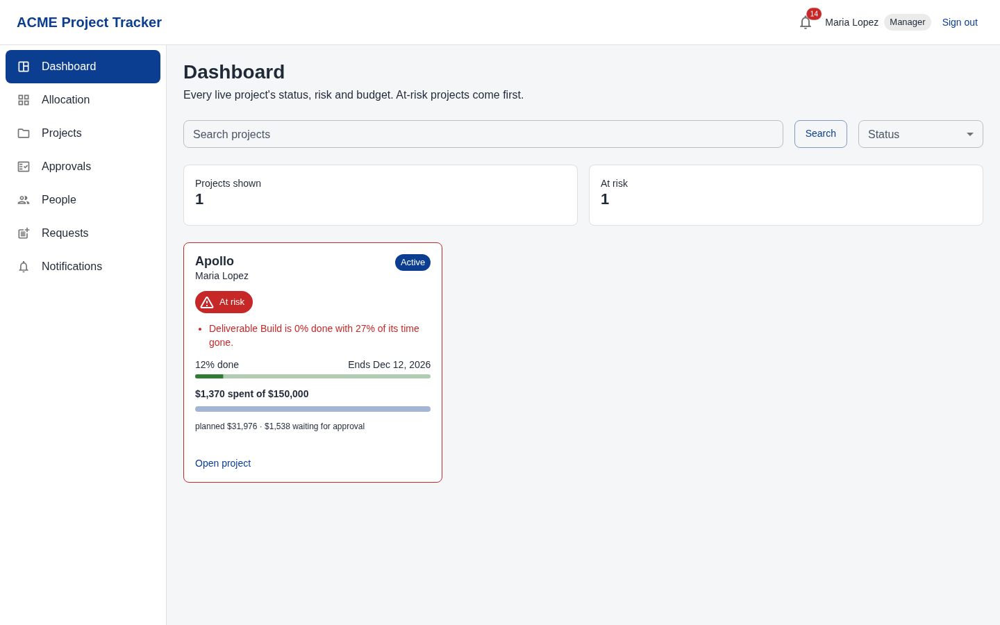
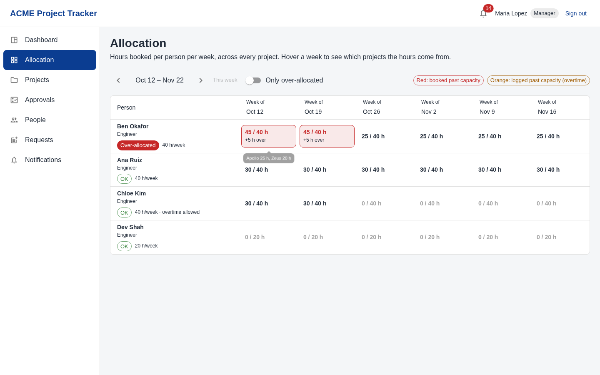
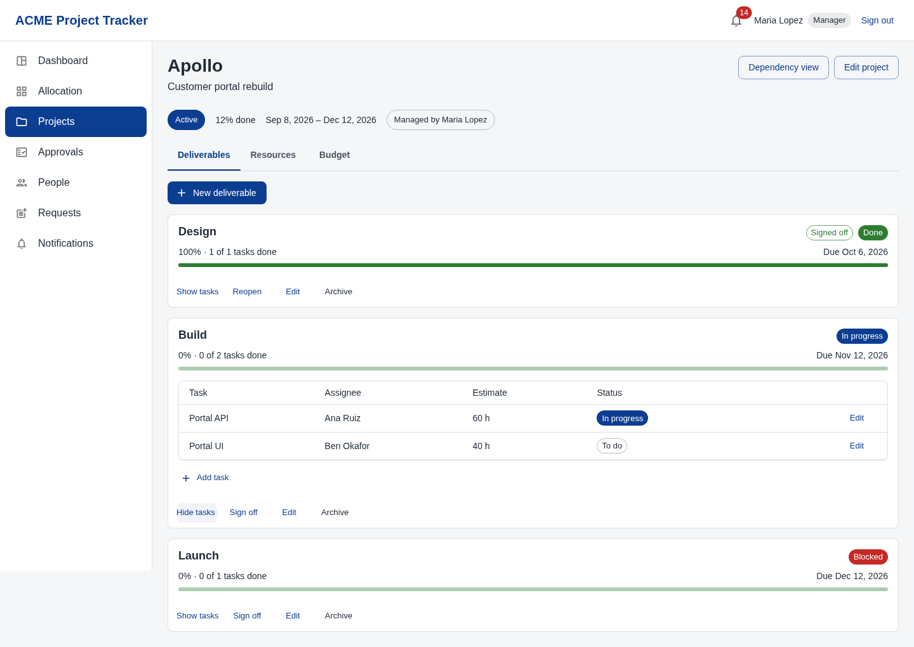
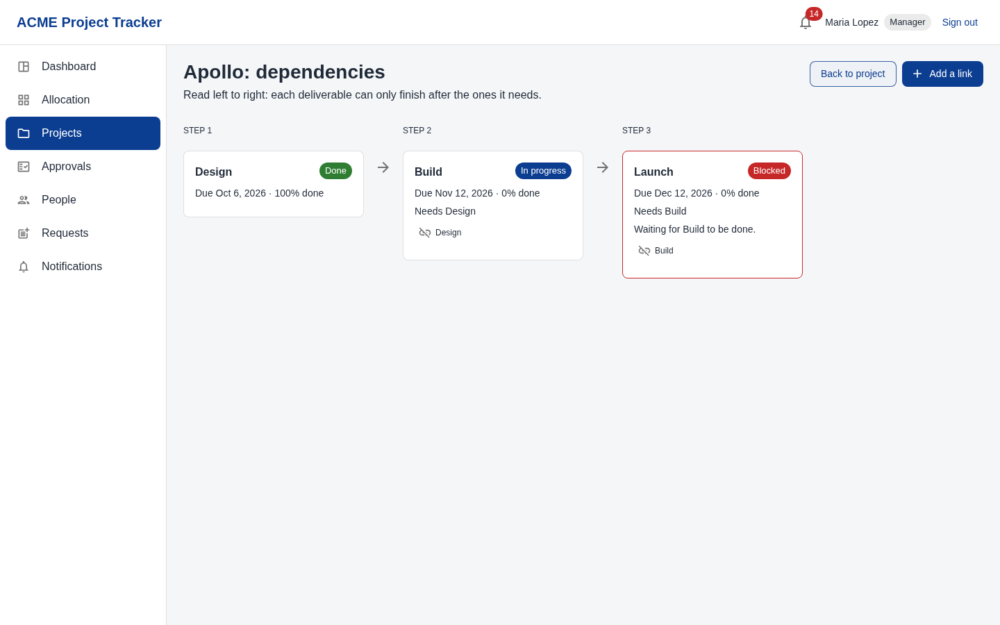
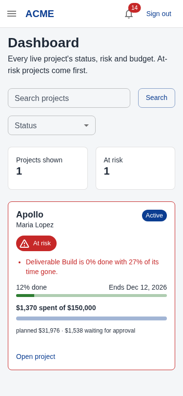

# ACME Project Tracker

A project-management and tracking platform for ACME Inc., built for the Citi coding
workshop (13 to 15 Oct 2026). It answers the client's seven questions from live data:
React with Material UI on the front, Python on AWS Lambda behind it,
PostgreSQL (Aurora) underneath, deployed with Terraform and the repo's shell scripts.

- How it works, how to demo it, likely questions: [docs/GUIDE.md](./docs/GUIDE.md)
- Scope, rules and screens: [MVP.md](./MVP.md)
- Database design and reasoning: [docs/superpowers/specs/2026-10-13-database-design.md](./docs/superpowers/specs/2026-10-13-database-design.md)
- Workshop guides: [docs/README.md](./docs/README.md)

## The seven questions, and where the answers come from

| # | Question | Computed by | Endpoint |
| --- | --- | --- | --- |
| 1 | Status of each active project | project status + progress from task estimates | `GET /dashboard/projects` (one card per project), `GET /projects` |
| 2 | Projects at risk of missing deadlines | past end date, overdue or behind-schedule deliverables, budget burning faster than time | `GET /dashboard/projects` (at risk first, with reasons), `GET /dashboard/at-risk` |
| 3 | Resource allocation across projects | bookings (hours/week per person per project), with the projects behind each week's hours | `GET /dashboard/allocation` |
| 4 | Key deliverables and completion | deliverable status and progress computed from their tasks | `GET /projects/{id}/milestones` |
| 5 | Over-allocated team members | weeks booked past each person's capacity (worst week first, `?overOnly=true`), and weeks logged past it | `GET /dashboard/allocation` |
| 6 | Dependency chain between deliverables | live dependency links, one project at a time | `GET /projects/{id}/dependency-graph` |
| 7 | Budget consumed vs planned | planned = bookings x rate; consumed = approved time x the rate frozen when logged | `GET /dashboard/projects`, `GET /projects/{id}/budget` |

We read the brief as a portfolio and resource-management problem (the category of
Float, Harvest Forecast and Smartsheet Resource Management), not task tracking (Jira,
Trello). So the manager lands on the dashboard (`/dashboard/projects`: status, risk and
budget per project, answering questions 1, 2 and 7 at a glance), then the allocation grid
(questions 3 and 5: who is over capacity, in which week, and which projects the hours come
from). Tasks exist only to make deliverable completion (question 4) a measured number.
The dashboard, the risk panel and the budget screen share one money query and one risk
function, so they can never disagree; each screen costs a fixed number of queries,
however many projects or people there are.

## Architecture

One Lambda, `backend/tracker/`: an entry point and four folders, with Postgres underneath.
Dependencies only point downward: nothing below `api/` knows HTTP exists.

```
request -> function.py      Lambda entry: one connection per warm instance, migrate on cold start
        -> api/             parse the event, match the route table, authorise, map errors to status codes
        -> services/        the business rules and their SQL; raise domain errors, know nothing about HTTP
        -> store/           Postgres connection and transactions, migrations, integrity queries
        -> PostgreSQL       constraints refuse bad rows even if a service has a bug
           domain/          errors, money, clock, values: shared by every layer, imports nothing else
```

- **`api/routes.py`** is the one route table: method, path, which roles may call it.
  `api/app.py` reads the token, then **re-reads the user's role from the database** on
  every request, so a demoted user's old token can't keep powers it no longer has.
- **Sessions (`services/tokens.py`, `services/sessions.py`).** Login returns a 15-minute
  access token (a JWT) and a refresh token (random, only its SHA-256 stored in
  `refresh_tokens`). `POST /auth/refresh` swaps the refresh token for a new pair and
  retires the old one; a retired token coming back means someone has a copy, so every
  session of that user ends. Every refresh token dies 8 hours after login. A password
  change, an admin reset or archiving a user ends that user's sessions
  (`users.password_changed_at`, migration 005).
- **`api/errors.py`** is the one table from domain error to status: 400 validation,
  401 not signed in, 403 role can't, 404 missing *or not yours* (identical messages,
  so ids can't be probed), 409 state refuses (over capacity, dependency loop), 503
  database down. The body is `{"error": ...}`, plus `field` when one input is at fault and
  `code` when the website should act on it: `OVER_CAPACITY` means "ask, then resend with
  `confirmOverCapacity: true`".
- **`services/`** holds the business rules (overlap and self-approval are Postgres only);
  rule tests call it directly, never through HTTP, which shows the rules don't need HTTP.
  What keeps the layers apart is the import direction: nothing below `api/` imports it
  (`api/app.py` does reach past `services/` for `store.postgres.translate_errors`).
- **`store/postgres.py`** opens every connection in autocommit mode and wraps every
  multi-statement write in `atomic()`. psycopg's default would silently never commit after a read;
  `tests/backend/test_store_commits.py` guards that.
- **Wire format:** JSON is camelCase; Python and SQL are snake_case. `services/views.py`
  names every output field, so a password hash can never leak.
- **Requests (`services/requests.py`):** everyone but admins asks. Managers ask the admins
  (new project, archive a project, free text); employees ask their line manager or an
  admin (higher task limit, overtime, free text). Who may decide is one SQL condition,
  the same people `record_change` notifies when the request is sent. Approving calls the
  existing service (`archive_project`, `set_capacity`) in the same transaction, so the
  same rules and audit rows apply, and the decision notifies the asker.
- **History (`GET /users/{id}/history`, `audit.person_history`):** one person's trail from
  the audit log: the changes they made and the changes to their account, newest first,
  filtered by action and date. Admins read anyone's, a manager their direct reports', and
  everyone their own (**History** on People, **My history** on Account); anyone else gets
  the same 404 as a missing id. Only admins get the before/after state: a user snapshot
  holds the salary, so for everyone else `views.audit_view` leaves both state keys out,
  and the one-line summary never contains it (`test_history_never_shows_salary_to_a_manager`).

### Data model (`backend/tracker/store/migrations/001_init.sql` to `004_over_capacity.sql`)

`users`, `projects`, `assignments` (bookings, "Resources" on screen), `milestones`
(deliverables), `milestone_dependencies`, `tasks`, `time_entries`, `project_requests`,
`audit_log`, `notifications`: ten tables for the app, plus `schema_migrations`, which the
migration runner keeps for itself. `002_task_limit.sql` adds one column, `users.task_limit`
(1 to 10, default 2), because the first file never changes once it has run on Aurora.
`003_request_kinds.sql` gives `project_requests` a `kind` (new project, archive a project,
task limit, overtime, other), with a check per kind; old rows default to new project.
`004_over_capacity.sql` adds `time_entries.over_capacity` (default false): the entry was
logged past capacity without overtime, after the person confirmed.
Money is integer cents. Nothing is deleted: a trigger refuses `DELETE` on every
application table, and records are archived and reactivated instead.

The database itself refuses whatever one row can prove wrong:

- a malformed username, a negative budget, or a 41-hour booking;
- overlapping bookings for one person on one project;
- a task on another project's deliverable, or time logged on another project's task;
- a dependency across projects;
- someone approving their own time.

Postgres enforces what a constraint can express; rules that need the clock, sums or the
caller (weekly capacity, sign-off, dependency loops, ownership) live in the services; the
five integrity queries catch what neither can prevent. Some rules are in both (booking
hours, date order), and some only in the database (overlap, self-approval).

**Integrity check** (`store/integrity.py`, `GET /admin/integrity-check`): five queries
that must always return no rows:

- no dependency loops;
- nothing live under an archived project;
- every record has its creation audit row;
- no time logged outside a booking;
- no signed-off deliverable with unfinished work.

They run after every database test.

### Business rules

- **Accounts:** admins create them. The server generates the username (initials plus 6
  digits, never changed) and a 12-character password, shown once and changed at first
  login. Passwords are hashed with PBKDF2-SHA256 at 600,000 rounds. An unknown username
  costs the same hashing work as a wrong password, so the reply time doesn't reveal which
  usernames exist (test: `test_unknown_username_costs_the_same_hashing_as_a_wrong_password`).
- **Projects:** admins create projects. A manager runs their own: description, dates,
  budget, status, bookings, deliverables, tasks.
- **Tasks:** employees move the tasks assigned to them and log time on them. They can't
  log on a future date or outside their booking, or more than 24 hours a day.
- **Pull board:** a manager can leave a task unassigned, and it shows as Ready. An
  employee booked on the project presses **Take this** (it becomes theirs and In progress),
  up to their task limit (default 2), and **Put back** returns it. Managers can still assign
  past the limit. In `services/tasks.py`, `claim_task` and `release_task` lock the task row,
  then the person's row, inside the same `atomic()` that writes the CLAIM or RELEASE audit
  row, so two people can't take one task and one person can't slip past the limit
  (`tests/backend/test_claim_race.py` runs both races on separate connections).
- **Capacity:** logging past a person's weekly capacity without overtime asks first
  (409, `code: "OVER_CAPACITY"`, "This puts you 2 h over your 40 h week. Log anyway?").
  Resent with `confirmOverCapacity: true`, it is saved, marked "Over capacity" on My
  logged time and Approvals, and the notification to the manager says by how much. With
  overtime on, it is saved unmarked and the week is flagged. Booking someone past capacity
  is allowed but flagged.
- **Approval:** the line manager or an admin approves logged time. Only approved time
  is charged.
- **Deliverables:** their status is computed. Sign-off is refused until all tasks and
  dependencies are done, and reopening work clears the sign-off down the chain.
- **Audit:** every change writes an audit row in the same transaction, and notifies
  the people above the actor (in-app bell): for an employee, their line manager, the admins
  and, for work on a project (a task, logged time), that project's manager.

## The website (`frontend/`)

React 19 with Material UI, react-responsive and React Router, built with Vite. It has one
screen per question, in the order a manager needs them:

| Dashboard (questions 1, 2, 7) | Allocation grid (questions 3, 5) |
| --- | --- |
|  |  |
| **Project (question 4): deliverables, tasks, resources, budget** | **Dependency view (question 6)** |
|  |  |

Three charts, drawn with plain MUI boxes and no chart library: a deliverables timeline on each project, and a budget chart and this week's workload on the dashboard. The server sends every percentage.

Also: login and the forced first password change; My account (your own name, email and password); My tasks (employees move status and
log time, typed in two boxes, Hours and Minutes; a **Ready to take** section); a **Board** tab on each project
(Ready, To do, In progress, Done, with Take this, Put back and Assign); Approvals; People (accounts, capacity,
overtime, task limit, password resets; a new or reset password is shown once, with a **Copy username
and password** button); Requests (everyone asks: Mine and To decide tabs for managers); Notifications (a bell polled every 10 s while the tab is visible, at once when you return to it, and after every change, with a pop-up when something new arrives); Audit log
(admins, with before/after changes). On phones the sidebar becomes a drawer, tables
become cards and the grid scrolls sideways ().

```
frontend/src/
  services/request.js   the one module that calls the API: base URL, token, JSON, errors
                        as { status, message, field }; on a 401 it refreshes once and
                        retries, and only if that fails signs out, in one place
  services/format.js    the only code that turns cents, minutes and dates into text (and
                        typed dollars into cents, as text, never floating point; typed
                        hours and minutes into minutes)
  auth/                 session (both tokens in sessionStorage, probed with /auth/me on load),
                        RequireRole (signed-out -> login, must change password -> there first)
  components/           layout, DataTable (table on desktop, cards on phones), FormDialog,
                        BudgetBar, StatusChip, PageState (loading / error with Retry / empty)
  components/charts/    the timeline, budget and workload charts, and their shared figure,
                        row and legend
  theme/chartColours.js the only chart colours, checked with a colour-blindness validator
  pages/                one folder per screen
```

- **No business rules in the browser.** Every figure (risk, progress, money, over
  capacity) comes from the server; the website formats it. Buttons a role can't use
  aren't shown, but the server is what refuses. The one exception is convenience, not a
  rule: the Hours and Minutes boxes check whole numbers and the server's own limits (24 h
  of logged time, 1,000 h of estimate) so the dialog can say which box is wrong; the server
  still enforces both.
- **Hash URLs** (`/#/projects/7`): the server only ever serves `index.html`, so CloudFront
  needs no rewrite rule (the one we removed also swallowed the API's 404s).
- **Server errors are shown as written**, on the field they concern when there is one
  ("2 tasks are not done yet", "This puts you 2 h over your 40 h week").

## Running it locally (on the VDI)

```sh
source ~/.bashrc && ./bin/start-dev.sh          # Postgres, LocalStack, deploys the Lambda, proxy :3001, Vite :3000
curl http://localhost:3001/api/tracker/health   # {"status": "ok"}
```

Then open `http://localhost:3000`. For demo data, run `tools/demo.py seed` (see "Live
demo" below); every seeded account's password is `Demo-pass-2026`.

The first admin is `AD000001`. Its generated password differs per environment:

```sh
AWS_ENDPOINT_URL=http://localhost.localstack.cloud:4566 AWS_ENDPOINT_URL_S3=http://s3.localhost.localstack.cloud:4566 \
AWS_ACCESS_KEY_ID=test AWS_SECRET_ACCESS_KEY=test AWS_REGION=us-east-1 \
  terraform -chdir=infra output -raw bootstrap_admin_password
```

## Tests

Local PostgreSQL must be running. The suite builds its own databases (`tracker_test`
and three scratch ones) and never touches the app's.

```sh
python3.13 -m venv .venv && .venv/bin/pip install -r requirements-dev.txt   # once
.venv/bin/pytest -q                                                        # 537 passed
.venv/bin/pytest -q tests/backend/test_work.py                             # one file
.venv/bin/pytest -q -k capacity                                            # tests whose name matches
.venv/bin/pytest --cov --cov-report=term-missing                           # coverage: 97% of our code
```

Against the rubric's coverage goals (`docs/full-stack.md`): backend 97% (goal 80%);
the API layer (`api/`: routing, auth, error mapping, every handler) 100% (goal 90%), with
every route in the table called by the two walk tests. They run in-process: a
Lambda-shaped event goes through the same entry point AWS uses. Real HTTP is exercised by
`tools/demo.py` and Playwright.

| File | What it proves |
| --- | --- |
| `test_schema.py`, `test_no_delete.py` | Postgres refuses each bad row by its named constraint; nothing can be deleted |
| `test_migrate.py`, `test_store_commits.py`, `test_function.py` | migrations are all-or-nothing and run once; writes really commit; cold start, first admin, 503s |
| `test_integrity.py` | each integrity query catches a deliberately planted violation |
| `test_users.py`, `test_audit.py`, `test_projects.py`, `test_work.py`, `test_requests.py`, `test_dashboard.py` | every business rule, calling services directly |
| `test_api.py` | routing (both path shapes), every non-public route needs a token, role from the database, 404 not 403, error and list shapes, no DELETE anywhere, refresh and logout over HTTP, a password change ends older tokens |
| `test_api_audit_walk.py` | calls every write route and checks each one left an audit row |
| `test_api_read_walk.py` | calls every read route and checks its shape; audit-log filters; malformed queries and bodies; a crash is a 500 with a generic message (`{"error": ...}`) |
| `test_domain.py`, `test_security.py` | validation, money, the Eastern-time clock, hashing (and that production stays at 600k rounds), tokens (valid at 14:59, refused at 15:00) |
| `test_sessions.py` | refresh tokens: only the hash is stored, rotation, fixed 8-hour expiry, reuse ends every session, logout twice is fine |

### Frontend tests

```sh
cd frontend
npm test                                  # 314 passed: Vitest + React Testing Library
npm run test:coverage                     # 94.93% of statements, 96.02% of lines
npm run lint                              # ESLint, clean
E2E_ADMIN_PASSWORD=... npm run e2e        # Playwright: a real browser against the running app
```

- **Component and screen tests** (beside the code, `*.test.jsx`) render each screen with
  the API stubbed at `fetch`, and check what a person would see and what gets sent:
  field names, cents, minutes, only-changed fields on edit, the server's refusals shown
  as written, role-dependent buttons, phone layout.
- **End to end** (`frontend/e2e/demo.spec.js`, against the local API and database): a
  manager signs in and walks the seven questions (dashboard, allocation, a project, its
  dependencies), and the dashboard at phone width has no sideways scrolling.
  `E2E_ADMIN_PASSWORD` is only used to look up the seeded manager's generated username.
  `requests.spec.js`: an employee asks her line manager, he rejects it with a note from
  To decide, and she reads the answer at phone width.
- Against the rubric's goals: frontend 94.93% of statements (goal 80%); the demo journey end to end.

**Known gaps (the uncovered 3% of the backend, 5% of the frontend):**

- a manager cannot put a task back to Ready from the screen (the Assign dialog has no
  empty choice); the API allows it (`PATCH /tasks/{id}` with `assigneeUserId: null`);
- guard branches in the services for ids that don't exist or records already archived
  (for example, archiving an archived task); the same guards are tested on other records;
- a handful of real rules with no test yet: reactivating a deliverable or task clears a
  sign-off (`milestones.py:197`, `tasks.py:215`); adding a dependency clears a sign-off
  (`milestones.py:291`); archived deliverables can't be in dependencies
  (`milestones.py:268`); a manager who still runs live projects can't be demoted
  (`users.py:239`);
- the database-down branch inside a request (the cold-start one is tested);
- in the frontend, mostly the People screen's less-used paths: an
  admin editing a person, "Show archived" and paging; plus the Reactivate buttons for an
  archived project or person;
- end to end covers the manager's demo journey and the phone layout; the employee
  journey (log time, then a manager approves) is covered by screen tests, not end to end;
- 2 of 16,184 requests at 25 users on AWS got no HTTP response (status 0) and are unexplained;
  the Lambda logged no error for them (below).

### Load test

`tools/loadtest.py` (standard library, like the demo) runs N simulated managers
looping over the dashboard's reads, then a burst of logins, and prints throughput,
p50/p95/max per endpoint and failures by status. It exits 1 if anything failed.

```sh
TRACKER_ADMIN_PASSWORD=... python3 tools/loadtest.py                        # 10 users, 20 s
TRACKER_ADMIN_PASSWORD=... python3 tools/loadtest.py --users 25 --seconds 60
```

Results on AWS (CloudFront, Lambda at 512 MB, Aurora Serverless v2; 13 Oct, seeded data):

| Users | Reads | Throughput | p50 / p95 | Failed | Login p50 / p95 |
| --- | --- | --- | --- | --- | --- |
| 10 | 4,190 | 209 req/s | 28–35 / 40–50 ms | 0 | 1.10 / 1.13 s |
| 25 | 16,184 | 539 req/s | 35–41 / 57–65 ms | 2 (0.01%, no response) | 1.11 / 1.13 s |

Inside Lambda a warm request takes 6 ms (p50) and 13 ms (p95), from the CloudWatch
`REPORT` lines; the rest is the network to CloudFront and back.

**What the load test found.** The `max` column (7 to 11 s) was cold starts, and the
CloudWatch logs showed them as a staircase: 1.3, 2.4, 3.4, 4.5 ... 9.8 s, each about 1.07 s
after the one before. Every cold start re-hashed the bootstrap admin's password
(600,000 rounds, about 1 s) inside the migration's advisory lock, even though the
admin already existed, so simultaneous cold starts queued. With the lock's 10 s timeout,
a bigger burst would have started answering 503. Fixed 13 Oct: `bootstrap_admin` checks
for the admin before hashing (test: `test_bootstrap_admin_skips_the_hash_once_the_admin_exists`).
Measured on AWS after the fix (25 users, same day): 25 simultaneous cold starts each
answered in 0.17 to 0.30 s, with no queue.

A login costs about 1.1 s whatever the load, because the password hash is deliberately
slow and CPU-bound. 1024 MB of Lambda memory would roughly halve it.

Results on LocalStack (VDI, 13 Oct, seeded data):

| Users | Reads | Throughput | p50 / p95 | Failed | Login p50 |
| --- | --- | --- | --- | --- | --- |
| 10 | 1,348 | 60 req/s | 108 / 225 ms | 0 | 1.0 s |
| 15 | 1,819 | 59 req/s | | 3 (0.2%) | 1.1 s |
| 25 | 2,120 | 35 req/s | 340 / 2,700 ms | 58 (2.7%) | 2.3 s |

Every failure was a 500 from LocalStack itself, not from our code: its container
has a 1,024 open-file limit, and past about 15 parallel Lambda environments it logs
`Could not start new environment ... Too many open files`. Our Lambda logged no
unhandled errors, and the demo and integrity check were clean afterwards.
Throughput levels off at about 60 req/s because the emulator runs everything on
one VDI. On AWS the same 10 users got 3.5 times the throughput with no failures.

## Live demo from the terminal

`tools/demo.py` talks to the API over HTTP, so it works locally and against the
deployed URL (set `TRACKER_API`).

```sh
read -rsp 'Admin password: ' TRACKER_ADMIN_PASSWORD; echo; export TRACKER_ADMIN_PASSWORD
python3 tools/demo.py seed   # once
python3 tools/demo.py demo
```

`seed` creates two managers and four employees (password `Demo-pass-2026`), three live
projects, bookings, a dependency chain, tasks, a week of logged time, requests and an
archived project. `demo` prints the seven answers, then tries to break the rules: over
capacity, a future date, another manager's project, an employee creating a project, a
dependency loop, signing off unfinished work, DELETE, no token. It ends on the
integrity check.

## Deploying to AWS

```sh
./bin/setup-participant.sh       # fresh temporary AWS credentials (they expire)
./bin/deploy-backend.sh          # terraform apply: Lambda, Aurora, CloudFront, secrets
./bin/deploy-frontend.sh         # builds the website, uploads it to S3, prints the CloudFront URL
terraform -chdir=infra output -raw bootstrap_admin_password   # right after the AWS deploy
```

The first request after a deploy migrates Aurora and creates `AD000001`.

## Trade-offs and assumptions

- **Archive instead of DELETE.** The rubric asks for DELETE returning 204. We archive,
  because deleting a project would make every cost figure that referenced it
  unreconstructable. There is no DELETE route and the database refuses deletes.
- **PATCH for edits:** a manager may change only some fields of a project.
- **Logged time, not payroll.** There's no clock-in, pay periods or overtime pay; those
  belong to HR systems. Cost is minutes x the hourly rate (salary / 2080) frozen on the
  entry when logged.
- **Cost arithmetic in SQL.** Budget and risk figures sum `minutes x rate / 60` in SQL,
  one aggregate query rather than a row-by-row loop, using the same rounding as
  `domain/money.py`. The budget test pins the two together.
- **Refresh token in the response body, not a cookie.** It sits in `sessionStorage` next to
  the access token. An HttpOnly cookie would hide it from page scripts, but locally the
  page (:3000) and the proxy (:3001) are different origins and the proxy answers
  `Access-Control-Allow-Origin: *`, which browsers never combine with cookies. Rotation
  and reuse detection limit a copied token: the second use signs both sides out. A
  duplicated browser tab copies `sessionStorage`, so whichever copy refreshes second
  signs both out ([design](./docs/superpowers/specs/2026-10-14-tokens-design.md)).
- **Secrets in Terraform state.** The JWT secret and the first admin's password are
  generated by Terraform, so they are in its state file. The forced password change
  limits the exposure.
- **"Today" is Eastern time,** from one constant (`domain/clock.py`).
- **Lambda memory is 512 MB,** because the 600k-round PBKDF2 login is CPU-bound and
  Lambda gives CPU in proportion to memory. We estimated 0.5 s; AWS measured about 1.1 s.
- **Known disclosure:** a manager who books one person can work out that person's rate
  from planned cost.
- **No email or text messages.** On AWS the Lambda runs on the organisers' role, which has
  no `ses:` permission, inside a private network with no NAT gateway or email/SNS
  endpoint, and our role can't create either. So a new or reset password is shown once to
  the admin and must be changed at first sign-in
  ([findings](./docs/superpowers/specs/2026-10-14-email-and-sms-findings.md)).
- **Known security gap.** Changing your own email needs no current password
  (`update_self`, `services/users.py`), which would matter once an emailed reset exists.

## Contributing

See the [CONTRIBUTING](./CONTRIBUTING.md) resource for more details.

## License

This library is licensed under the MIT-0 License.
See the [LICENSE](./LICENSE) resource for more details.

## Roadmap

See the
[open issues](https://github.com/citi/coding-workshop-participant/issues)
for a list of proposed roadmap features (and known issues).

## Security

See the
[Security Issue Notifications](./CONTRIBUTING.md#security-issue-notifications)
resource for more details.

## Authors

The following people have contributed to this workshop:

* Colin Heilman - [@heilmancs](https://github.com/heilmancs)
* Eugene Istrati - [@eistrati](https://github.com/eistrati)
* Isaiah Cornelius Smith - [@corneliusmith](https://github.com/corneliusmith)
* Juan Arevalo - [@jparevalo27](https://github.com/jparevalo27)
* Michael Annucci - [@michael-annucci](https://github.com/michael-annucci)

## Feedback

We'd love to hear your feedback! Please:

* ⭐ Star the repository if you find it helpful
* 🐛 Report issues on GitHub
* 💡 Suggest improvements
* 📝 Share your experience
